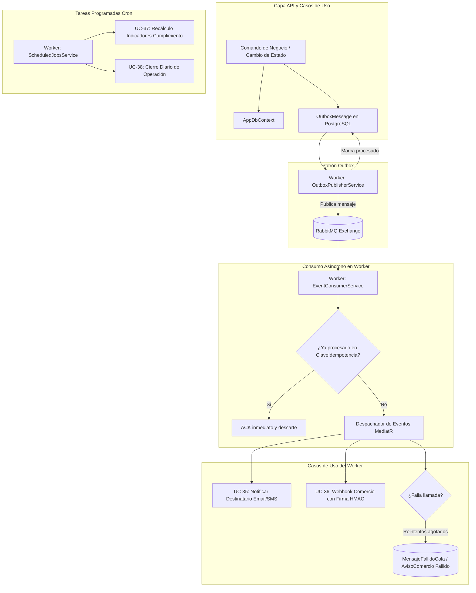

# Plan de Especificación e Implementación Técnica: Worker Service en Segundo Plano (`UltimaMilla.Worker`)

## 1. Resumen Ejecutivo y Marco Normativo

El presente documento define la especificación técnica integral para la implementación del servicio en segundo plano (**Worker Service**) de la plataforma de última milla. 

El diseño se fundamenta estrictamente en los requerimientos del cliente y la cátedra:
- **Letra del Laboratorio**:
  - Sección 4 (*Alcance: aplicaciones a construir - Servicio de procesamiento en segundo plano worker .NET*).
  - Sección 6.8 (*Mensajería asíncrona y procesamiento en segundo plano: Outbox, Idempotencia, Reintentos, DLQ*).
  - Sección 6.9 (*Avisos automáticos a los comercios: Webhooks, firma HMAC, reintentos, panel de fallidos y receptor de prueba*).
  - Sección 6.12 (*Observabilidad: CorrelationId de extremo a extremo, métricas de cola y fallos*).
- **Documento de Análisis y Diseño (ADR-001 y ADR-002)**:
  - Arquitectura limpia (Clean Architecture) con CQRS ligero.
  - Aislamiento multitenant por fila con `ICurrentTenant`.
  - Concurrencia optimista y trazabilidad de eventos.
- **Matriz de Casos de Uso (Actor Sistema)**:
  - **UC-35**: Notificar cambio de estado al destinatario (RF-27).
  - **UC-36**: Entregar aviso automático al sistema del comercio (RF-28).
  - **UC-37**: Recalcular indicadores de cumplimiento (RF-30).
  - **UC-38**: Ejecutar cierre diario de la operación.

---

## 2. Diagnóstico del Estado Actual (*As-Is*)

```
UltimaMilla.sln
├── src/Domain
│   ├── Entities/Mensajeria/       → OutboxMessage, MensajeFallidoCola, ClaveIdempotenciaConsumidor [YA EXISTEN]
│   ├── Entities/Seguimiento/      → AvisoComercio, SuscripcionAviso, Notificacion [YA EXISTEN]
│   └── Entities/Incidencias/      → IndicadorCumplimiento, CierreDiarioOperacion [YA EXISTEN]
├── src/Application
│   └── Ports/IOutboxStorage.cs    → Puerto de guardado básico de Outbox [YA EXISTE]
├── src/Infrastructure
│   ├── Persistence/AppDbContext   → Mapea OutboxMessages y MensajeFallidoCola [EXISTE]
│   └── Persistence/Repositories/  → EfOutboxStorage.cs (solo persistencia) [EXISTE]
├── src/Worker
│   ├── Program.cs                 → Host básico con AddHostedService<Worker>()
│   ├── Worker.cs                  → Bucle de latido activo (Heartbeat c/30s) sin conexión real [ESQUELETO]
│   └── Dockerfile                 → Dockerfile listo, no integrado aún en docker-compose.yml
└── docker-compose.yml             → Servicios: Postgres, Redis, RabbitMQ (puertos 5672/15672), Api, Backoffice, Portal
```

### Hallazgos clave:
1. **El modelado de dominio ya está completo y es consistente**: Las entidades requeridas para mensajería, webhooks, notificaciones y métricas ya están programadas y siguen las reglas de invariantes (`DomainValidationException`).
2. **Falta la orquestación en Infrastructure y Application**: No existen los servicios de consumo/publicación de RabbitMQ, los handlers de los casos de uso del Sistema (UC-35 a UC-38) ni la configuración de reintentos con Polly/backoff.
3. **El Worker es un proceso en blanco**: Solo registra un log cada 30 segundos; requiere transformarse en un host que aloje los `BackgroundService`s específicos.

---

## 3. Arquitectura del Worker y Flujo de Mensajería

El Worker se concibe como un **Host de Ejecución desacoplado de la API**, que comparte `Application` y `Infrastructure` sin exponer puertos HTTP públicos a usuarios.



---

## 4. Desglose de Componentes a Implementar

### Componente 1: Publicador Outbox (`OutboxPublisherBackgroundService`)
* **Ubicación:** `src/Worker/BackgroundServices/OutboxPublisherBackgroundService.cs`
* **Objetivo:** Garantizar entrega *al menos una vez* (*at-least-once delivery*) sin riesgo de inconsistencia transaccional (dual-write).
* **Comportamiento:**
  1. Se ejecuta periódicamente con intervalo configurable (ej. cada 3 a 5 segundos).
  2. Abre un `IServiceScope` para resolver `AppDbContext` de forma segura.
  3. Consulta en batch (ej. primeros 50 registros) los `OutboxMessages` donde `Procesado == false` ordenados por `CreadoEn`.
  4. Para cada mensaje:
     - Publica el evento en RabbitMQ (`operacion.eventos`) incluyendo en los metadatos: `MessageId`, `TipoEvento`, `AgregadoOrigen`, `Timestamp` y el `CorrelationId`.
     - Si la publicación es confirmada por RabbitMQ, invoca `mensaje.MarcarProcesado()`.
  5. Guarda los cambios con `SaveChangesAsync()`.
  6. Si RabbitMQ no está disponible, captura la excepción, registra log de advertencia y no marca los mensajes, permitiendo que la siguiente iteración los retome de forma transparente.

---

### Componente 2: Consumidor Asíncrono con Idempotencia (`EventConsumerBackgroundService`)
* **Ubicación:** `src/Worker/BackgroundServices/EventConsumerBackgroundService.cs`
* **Objetivo:** Consumir eventos de la cola de RabbitMQ y ejecutar los casos de uso correspondientes garantizando **idempotencia** (§6.8).
* **Comportamiento:**
  1. Se conecta a RabbitMQ usando `IModel` / `IChannel` y declara la cola principal de eventos con su dead-letter exchange (DLX).
  2. Al recibir un mensaje:
     - Extrae el identificador único (`MessageId`) y el `CorrelationId`.
     - Abre un scope de inyección de dependencias.
     - **Control de Idempotencia:** Consulta en la base de datos si existe un registro en `ClaveIdempotenciaConsumidor` para ese `MessageId`.
     - Si ya existe: emite log estructurado de advertencia (`"Mensaje duplicado descartado por clave de idempotencia"`), confirma el ACK a RabbitMQ y finaliza sin reejecutar la lógica.
     - Si no existe: despacha el evento al handler correspondiente según `TipoEvento`.
     - Si el procesamiento finaliza con éxito: guarda el registro en `ClaveIdempotenciaConsumidor` y confirma el ACK a RabbitMQ.

---

### Componente 3: Gestión de Reintentos y Cola de Fallidos (DLQ)
* **Ubicación:** `src/Infrastructure/Messaging/RabbitMqFaultHandler.cs`
* **Políticas exigidas (§6.8):**
  - **Reintentos con espera creciente (Backoff exponencial):** Intentos automáticos espaciados (ej: intento 1 a los 5s, intento 2 a los 20s, intento 3 a los 60s).
  - **Cola de mensajes fallidos:** Si se agotan los reintentos permitidos (por defecto 3), el mensaje se deriva a la tabla relacional `MensajeFallidoCola` y a la cola DLQ en RabbitMQ.
  - **Visibilidad y reintento manual:**
    - Se implementa el comando `ReintentarMensajeFallidoCommand` en `Application`.
    - Se habilita un endpoint en `Api` (`POST /api/operacion/mensajes-fallidos/{id}/reintentar`) para que el Administrador pueda consultar la lista de fallos y forzar su reejecución cuando el servicio externo o base de datos se restablezca.

---

### Componente 4: UC-35 - Notificar Cambio de Estado al Destinatario (RF-27)
* **Actor:** Sistema (disparado automáticamente por el worker al procesar un evento de cambio de estado).
* **Flujo:**
  1. El worker recibe un evento de cambio de estado relevante (`Admitido`, `EnTransito`, `Entregado`, `NoEntregado`, `Reprogramado`).
  2. Obtiene los datos del envío y del destinatario (teléfono, email, nombre).
  3. Resuelve el puerto `INotificacionDestinatarioService`:
     - En desarrollo y pruebas: Genera log estructurado seguro (con datos PII enmascarados según Regla 05) y persiste la entidad `Notificacion` en base de datos.
     - En producción: Adaptador extensible a proveedor SMTP / SMS Gateway.
  4. La entidad `Notificacion` (`EnvioId`, `Canal`, `TipoEvento`, `EstadoEnvio`, `Timestamp`) queda registrada para auditoría y consulta en el historial del envío.

---

### Componente 5: UC-36 - Entregar Aviso Automático al Comercio (Webhooks) (RF-28, §6.9)
* **Actor:** Sistema (disparado ante cualquier cambio de estado del envío).
* **Flujo Técnico:**
  1. Identifica el comercio origen a través del `ComercioOperadorId`.
  2. Consulta si existe una `SuscripcionAviso` activa (`Activa == true`) para el `TipoEvento` ocurrido.
  3. Si existe suscripción:
     - Construye el payload estandarizado JSON:
       ```json
       {
         "evento": "EnvioEntregado",
         "envioId": "GUID",
         "codigoSeguimiento": "UY-123456",
         "estado": "Entregado",
         "timestamp": "2026-10-26T23:30:00Z"
       }
       ```
     - **Firma Criptográfica HMAC-SHA256:** Calcula la firma digital del payload usando la `ClaveFirma` del comercio:
       $$\text{Signature} = \text{HMAC-SHA256}(\text{ClaveFirma}, \text{PayloadJson})$$
       La firma se envía en la cabecera HTTP: `X-Hub-Signature-256: sha256=<hex_hash>`.
     - Registra la entidad `AvisoComercio` en estado `"Pendiente"`.
     - Realiza la llamada HTTP POST mediante `IHttpClientFactory` con timeout controlado (10 segundos).
  4. **Control de Fallas y Reintentos:**
     - Si el webhook responde `2xx`: Invoca `aviso.MarcarEntregado(respuestaHttp)`.
     - Si el webhook falla (timeout, 4xx, 5xx): Invoca `aviso.RegistrarFallo(error, proximoReintento)`. Aplica reintentos crecientes (1m, 5m, 15m).
     - Si se superan los reintentos: El aviso pasa a estado `"Fallido"`.
  5. **Panel del Comercio y Reenvío:**
     - Query: `ObtenerAvisosComercioQuery` para ver historial de entregas y errores en el portal del comercio.
     - Command: `ReintentarAvisoComercioCommand` para reintentar manualmente un aviso fallido.
  6. **Receptor de Prueba (Mock Webhook Receiver) (§6.9):**
     - Endpoint en `Api` (`POST /api/testing/webhook-receiver`) con configuración para alternar entre `200 OK`, `500 Internal Error` o simulación de timeout, permitiendo demostrar en la defensa oral todos los escenarios de resiliencia y verificación de firma.

---

### Componente 6: UC-37 - Recalcular Indicadores de Cumplimiento (RF-30, §4)
* **Actor:** Sistema (ejecución periódica programada).
* **Ubicación:** `src/Worker/BackgroundServices/ScheduledJobsBackgroundService.cs` y `Application/CasosDeUso/Indicadores/`.
* **Flujo:**
  1. Se ejecuta periódicamente (ej. cada noche o al cierre del turno).
  2. Itera sobre cada operador activo (multitenant).
  3. Ejecuta la agregación de envíos en el período:
     - Total de envíos comprometidos.
     - Envíos entregados dentro de la ventana horaria prometida (`EntregadosEnPlazo`).
     - Envíos entregados fuera de la ventana horaria (`EntregadosFueraDePlazo`).
     - Envíos que no pudieron ser entregados (`NoEntregados`).
  4. Calcula el porcentaje de efectividad:
     $$\% \text{ Cumplimiento} = \frac{\text{EntregadosEnPlazo}}{\text{TotalEnvios}} \times 100$$
  5. Persiste o actualiza la entidad `IndicadorCumplimiento` agrupada por operador, zona de cobertura, repartidor y comercio.

---

### Componente 7: UC-38 - Ejecutar Cierre Diario de la Operación (§4)
* **Actor:** Sistema (ejecución al finalizar la jornada operativa).
* **Flujo:**
  1. El cron job del worker dispara el comando `EjecutarCierreDiarioCommand`.
  2. Por cada operador logístico:
     - Identifica todas las hojas de ruta del día y valida su estado (todas deben estar completadas o liquidadas con sus rendiciones en depósito).
     - Identifica los envíos en curso, entregados, devueltos e incidencias abiertas.
     - Genera un resumen consolidado en formato JSON estructurado:
       ```json
       {
         "fecha": "2026-10-26",
         "totalHojasDeRuta": 12,
         "totalEnvios": 240,
         "entregados": 225,
         "fallidos": 10,
         "enDevolucion": 5,
         "incidenciasAbiertas": 2
       }
       ```
     - Persiste la entidad `CierreDiarioOperacion(id, operadorId, fecha, resumenJson)`.
  3. Genera un evento de auditoría y notifica a través del log estructurado que el cierre concluyó satisfactoriamente.

---

## 5. Mapeo de Archivos a Crear y Modificar

| Capa | Archivo / Componente | Acción | Responsabilidad |
|---|---|---|---|
| **Domain** | `Entities/Mensajeria/` y `Seguimiento/` | Existentes | Entidades ya existentes (`OutboxMessage`, `AvisoComercio`, `IndicadorCumplimiento`, etc.). |
| **Application** | `Ports/IMessagePublisher.cs` | Crear | Puerto para publicar eventos en la cola de mensajes. |
| **Application** | `Ports/IWebhookSender.cs` | Crear | Puerto para realizar llamadas HTTP firmadas a los comercios. |
| **Application** | `Ports/INotificacionDestinatarioService.cs` | Crear | Puerto para notificar a destinatarios (SMS/Email). |
| **Application** | `CasosDeUso/Mensajeria/ReintentarMensajeFallidoCommand.cs` | Crear | Comando de reintento manual de DLQ. |
| **Application** | `CasosDeUso/Webhooks/` | Crear | Comandos y queries para gestión de suscripciones y avisos a comercios. |
| **Application** | `CasosDeUso/Indicadores/` | Crear | Lógica de agregación para UC-37 y UC-38. |
| **Infrastructure** | `Persistence/AppDbContext.cs` | Modificar | Agregar DbSets faltantes (`AvisosComercio`, `SuscripcionesAviso`, `Notificaciones`, `IndicadoresCumplimiento`, `CierresDiariosOperacion`). |
| **Infrastructure** | `Messaging/RabbitMqMessagePublisher.cs` | Crear | Implementación de publicación sobre RabbitMQ. |
| **Infrastructure** | `Messaging/RabbitMqConnectionFactory.cs` | Crear | Gestión de conexión resiliente con RabbitMQ. |
| **Infrastructure** | `Http/HttpWebhookSender.cs` | Crear | Cliente HTTP con firma HMAC-SHA256 y resiliencia. |
| **Infrastructure** | `Services/StubNotificacionDestinatarioService.cs` | Crear | Implementación segura para desarrollo/testing con enmascaramiento PII. |
| **Worker** | `UltimaMilla.Worker.csproj` | Modificar | Agregar dependencias (`RabbitMQ.Client`, referencia a `Infrastructure`). |
| **Worker** | `Program.cs` | Modificar | Composición de DI: `AddInfrastructure()`, `AddApplicationServices()`. |
| **Worker** | `BackgroundServices/OutboxPublisherService.cs` | Crear | Poller de base de datos y despachador de Outbox a RabbitMQ. |
| **Worker** | `BackgroundServices/EventConsumerService.cs` | Crear | Consumidor asíncrono con verificación de idempotencia. |
| **Worker** | `BackgroundServices/ScheduledJobsService.cs` | Crear | Planificador cron para indicadores (UC-37) y cierre diario (UC-38). |
| **Api** | `Endpoints/OperacionEndpoints.cs` | Modificar | Endpoints para consultar/reintentar mensajes fallidos y receptor mock de prueba. |
| **Docker** | `docker-compose.yml` | Modificar | Registrar el servicio `worker` para que corra junto a postgres y rabbitmq. |

---

## 6. Manejo Multitenant en Procesos de Background

> [!IMPORTANT]
> A diferencia de las solicitudes HTTP donde el operador se extrae de los claims del JWT o subdominio, en el Worker no existe un `HttpContext`.
> 
> **Estrategia a seguir (conforme a ADR-002):**
> 1. Cada evento publicado en el Outbox y en RabbitMQ **debe contener en sus metadatos el `OperadorId`**.
> 2. Al consumir un mensaje, el worker crea un `IServiceScope`.
> 3. En ese scope, se resuelve la interfaz `ICurrentTenant` y se le asigna el `OperadorId` del mensaje (`currentTenant.SetTenant(operadorId)`).
> 4. De este modo, los filtros globales de EF Core continúan aislando los datos correctamente y evitando cualquier fuga entre operadores.
> 5. Para tareas globales como el cierre diario (UC-38), el servicio itera sobre los operadores activos ejecutando cada cierre dentro de un scope con su respectivo tenant.

---

## 7. Plan de Verificación y Testing Exhaustivo (Regla 08)

Siguiendo la **Regla 08 de Testing**, se deben implementar pruebas automatizadas que cubran:

1. **Idempotencia de consumo:**
   - Enviar el mismo mensaje dos veces con el mismo `MessageId`.
   - Validar que la segunda ejecución detecte la clave existente en `ClaveIdempotenciaConsumidor`, no invoque la lógica de negocio y devuelva ACK sin duplicar registros.
2. **Resiliencia ante caída del broker:**
   - Simular indisponibilidad de RabbitMQ mientras corre el `OutboxPublisherService`.
   - Validar que los mensajes permanezcan en `Procesado == false` y se recuperen automáticamente al restaurar la conexión.
3. **Firma criptográfica y fallos de webhook:**
   - Test unitario que valide que la firma HMAC-SHA256 generada coincida exactamente con la esperada por el receptor.
   - Test de simulación de webhook caído (código 503): validar que `AvisoComercio` pase a `Reintentando` con fecha de próximo reintento y se derive a `Fallido` al superar los intentos.
4. **Boundary cases en indicadores:**
   - Operador con 0 envíos (no debe producir división entre cero; porcentaje debe ser `0.00%`).
   - Todos los envíos fallidos o fuera de plazo.

---

## 8. Pasos de Ejecución Recomendados

1. **Fase 1 (Infraestructura y DbContext):** Mapear los DbSets restantes en `AppDbContext` e instalar el cliente de RabbitMQ (`RabbitMQ.Client`) en `Infrastructure` y `Worker`.
2. **Fase 2 (Outbox Publisher y Consumer Idempotente):** Implementar la publicación de `OutboxMessage` y el consumidor base con `ClaveIdempotenciaConsumidor`.
3. **Fase 3 (Webhooks UC-36 y Notificaciones UC-35):** Implementar el cliente HTTP con firma HMAC y el servicio de notificaciones.
4. **Fase 4 (Jobs Programados UC-37 y UC-38):** Implementar los handlers y timers para indicadores y cierre diario.
5. **Fase 5 (Testing y Docker):** Escribir la suite xUnit y agregar el contenedor en `docker-compose.yml`.
